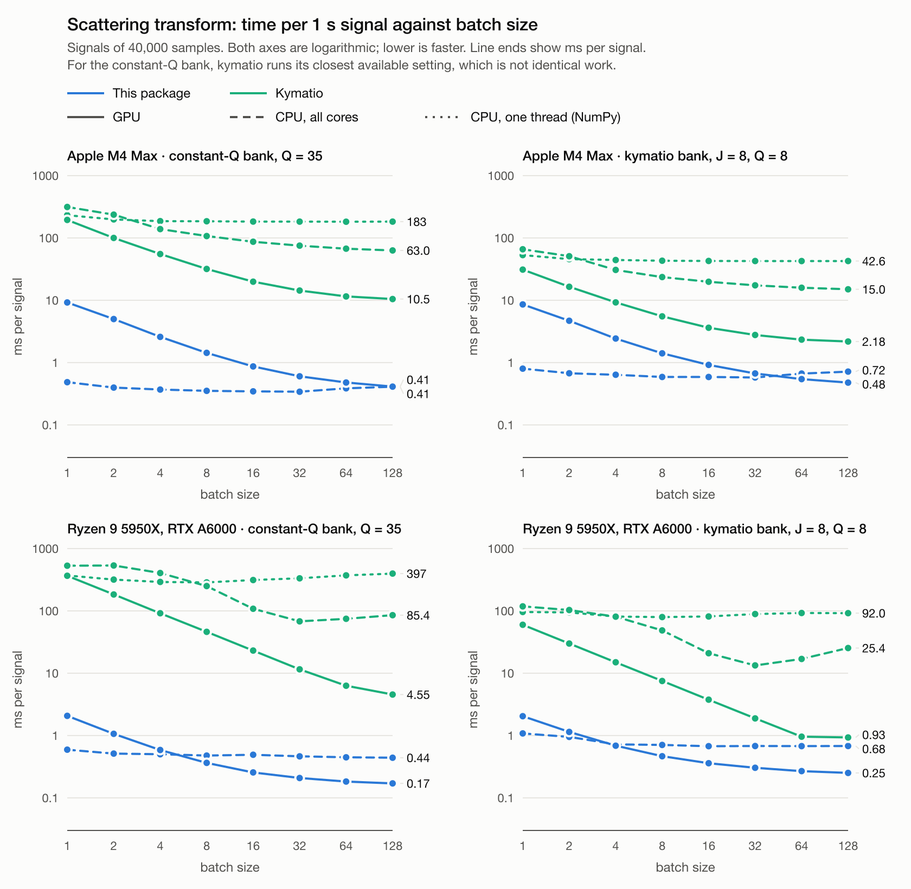

# Scattering1D.jl

[](https://github.com/org-arl/Scattering1D.jl/actions/workflows/CI.yml) [](https://codecov.io/gh/org-arl/Scattering1D.jl)

A fast 1D scattering transform for Julia, on CPU threads and on GPUs.

Given a batch of signals, it returns three sets of coefficients on a common time axis:

- `S0`: the low-passed signal.
- `S1`: the low-passed envelope of each frequency band.
- `S2`: the low-passed envelope of each modulation frequency within each band.

The values are raw and linear. Taking logarithms or normalizing is left to the caller.

## Installation

From the Julia package prompt:

```
pkg> add https://github.com/org-arl/Scattering1D.jl
```

## Quick start

```julia
using Scattering1D

fs = 40_000                                   # sampling rate, Hz
ψ1 = Morlets(250, 20_000, 35)                 # 250 Hz to 20 kHz, 35 per octave
ψ2 = Morlets(4, Inf, 1; crossover=3.0)        # modulation: from 4 Hz, 1 per octave
spec = ScatteringSpec(fs, 225, ψ1, ψ2)        # 225 time bins per signal

x = randn(Float32, 40_000, 16)                # samples × batch
plan = ScatteringPlan(spec, x)
c = scattering(plan, x)

size(c.S0)  # (225, 16)            time × batch
size(c.S1)  # (225, 222, 16)       time × band × batch
size(c.S2)  # (225, 10, 222, 16)   time × modulation × band × batch
```

Signals are the columns of a matrix. A single signal is a matrix with one column: `reshape(x, :, 1)`.

Building a plan takes a few seconds, because it measures FFT plans. Build it once and reuse it.

## What the dimensions mean

```julia
frequencies(spec)   # center frequency of each band, Hz
bandwidths(spec)    # standard deviation of each band's response, Hz
modulations(spec)   # center frequency of each modulation wavelet, Hz
mask(spec)          # modulation × band, true where S2 is computed
times(spec, 40_000) # center time of each bin, s, for 40,000-sample signals
```

A modulation wavelet is applied to a band only if its center frequency is at most `cutoff` (default 6) times the band's bandwidth. Narrow bands therefore get fewer modulation wavelets than wide ones. Entries of `S2` where `mask(spec)` is `false` are never written: they are zero in arrays made by `scattering` or `Coefficients`.

## Reusing output arrays

`scattering!` writes into arrays that already exist, so a loop over batches allocates almost nothing:

```julia
c = Coefficients(plan, 16)     # zeroed output arrays for batches of 16
for x in batches
  scattering!(c, plan, x)
  # use c.S0, c.S1, c.S2
end
```

## First order only

`first_order` returns `S0` and `S1` and skips all second-order work, which is most of the cost. It uses the same plan.

```julia
f = first_order(plan, x)       # f.S0, f.S1
f = FirstOrder(plan, 16)
first_order!(f, plan, x)
```

## Gradients

Gradients with respect to the signals pass through `scattering` and `first_order`, so the transform can sit after trainable steps or inside a loss function. The filters are fixed: there is no gradient with respect to them.

With Zygote:

```julia
using Scattering1D, Zygote

loss(x) = sum(abs2, scattering(plan, x).S1)
x̄ = Zygote.gradient(loss, x)[1]      # same size as x
```

Mooncake works the same way once it is loaded. Enzyme needs ChainRulesCore loaded as well: `using Enzyme, ChainRulesCore`.

Without an automatic-differentiation package, `backpropagate(plan, x, c̄)` returns the gradient with respect to `x` given the gradients `c̄` with respect to the coefficients, as a `Coefficients` or a `FirstOrder`. `backpropagate!(x̄, plan, x, c̄)` writes into an existing array.

A gradient costs about two forward transforms on CPU threads and about four on a GPU. The first one after building a plan takes a few seconds longer, while the reverse FFT plans are measured.

## GPUs

The kind of array given to `ScatteringPlan` selects the device. The coefficients come back as arrays of the same kind.

```julia
using CUDA                     # or: using Metal
xg = CuArray(x)                # or: MtlArray(x)
plan = ScatteringPlan(spec, xg)
c = scattering(plan, xg)
```

- A plan for an `Array` runs on CPU threads and accepts any batch size. Start Julia with threads, for example `julia -t 12`.
- A plan for a GPU array accepts only the batch size it was built with. Build one plan per batch size.
- GPUs need large batches to pay off. On small batches the CPU is faster.
- Apple GPUs support `Float32` only.

A plan holds work buffers and must not be used from several tasks at once.

## Settings

`Morlets(fmin, fmax, Q; crossover=1.0)` describes a constant-Q bank of Morlet wavelets: center frequencies `fmin·2^(k/Q)` up to `fmax`, with Gaussian responses whose neighbors cross `crossover` standard deviations from their centers. A larger `crossover` gives narrower, less overlapping filters.

`ScatteringSpec(fs, bins, ψ1, ψ2; ...)` takes these keywords:

| Keyword | Default | Meaning |
|---|---|---|
| `cutoff` | 6.0 | Highest modulation frequency applied to a band, in bandwidths of that band |
| `attenuation` | 0.1 | Gain of the smoothing low-pass filter at the output Nyquist frequency |
| `reach` | 6.0 | How far, in filter bandwidths, an envelope's spectrum is kept. Larger is more accurate and slower |
| `ε` | 1e-3 | Filter responses below this are treated as zero |
| `padding` | 2.5 | Reflection padding per side, in time-domain standard deviations of the longest filter |

`ψ2.fmax` may be `Inf`, which leaves `cutoff` as the only upper limit on modulation frequency.

Not every number of bins is possible for every signal length, because the padded signal must hold a whole number of output samples and have an FFT-friendly length. `ScatteringPlan` throws an `ArgumentError` when no such length exists; a nearby bin count usually works.

## Conventions

- **Filters** are Morlet wavelets defined in the frequency domain, with unit peak gain and zero gain at 0 Hz. First-order filters are zero at and above the Nyquist frequency.
- **Edges.** Each signal is extended once by reflection, transformed, and the extension is cut from the output. Signals in a batch are independent.
- **Time bins** are centered on equal intervals of the signal: bin `j` of `bins` covers samples `(j-1)·n/bins` to `j·n/bins`.
- **Smoothing** is the same Gaussian low-pass filter for every order.

## Other packages

Scattering1D.jl does one thing: a two-order scattering transform of 1D signals with fixed Morlet wavelets, as fast as it can. It has no trainable filters, no other wavelets, and no 2D or 3D transform. If you need any of those, these packages are a better fit:

- [ScatteringTransform.jl](https://github.com/BoundaryValueProblems/ScatteringTransform.jl), in Julia, is a general scattering framework. Its filters can be trained. It supports any number of layers, other wavelet families and nonlinearities, and 2D signals.
- [Kymatio](https://github.com/kymatio/kymatio), in Python, provides 1D, 2D and 3D scattering transforms with NumPy, PyTorch, TensorFlow, JAX, Keras and scikit-learn frontends.

## Accuracy

With the default settings the coefficients differ from an exact evaluation of the same transform by under 0.1% for `S1` and about 0.4% for `S2` as a whole. The highest modulation wavelet of each band is less accurate, about 3%, because part of its response lies beyond `reach`. Setting `reach=12` brings that to about 0.4% and takes about 1.5 times as long.

## Performance



Time per 1 s signal at 40 kSa/s with the settings of the quick start, at a batch of 128:

| Device | ms per signal |
|---|---|
| NVIDIA RTX A6000 | 0.17 |
| Apple M4 Max, 12 CPU threads | 0.41 |
| Apple M4 Max, GPU | 0.41 |
| AMD Ryzen 9 5950X, 16 CPU threads | 0.44 |

## Tests and benchmarks

```
julia --project=. -t auto -e 'using Pkg; Pkg.test()'
```

The tests compare the package with a slow, independent evaluation of the same transform (`test/oracle.jl`) and with saved output from [kymatio](https://github.com/kymatio/kymatio) (`test/kymatio.jl`).

GPU tests and timings live with each device's environment in `devices/metal` and `devices/cuda`; see `devices/cuda/README.md`. CPU and kymatio timings are in `benchmark`, and `julia benchmark/plot.jl` redraws the graph above.
